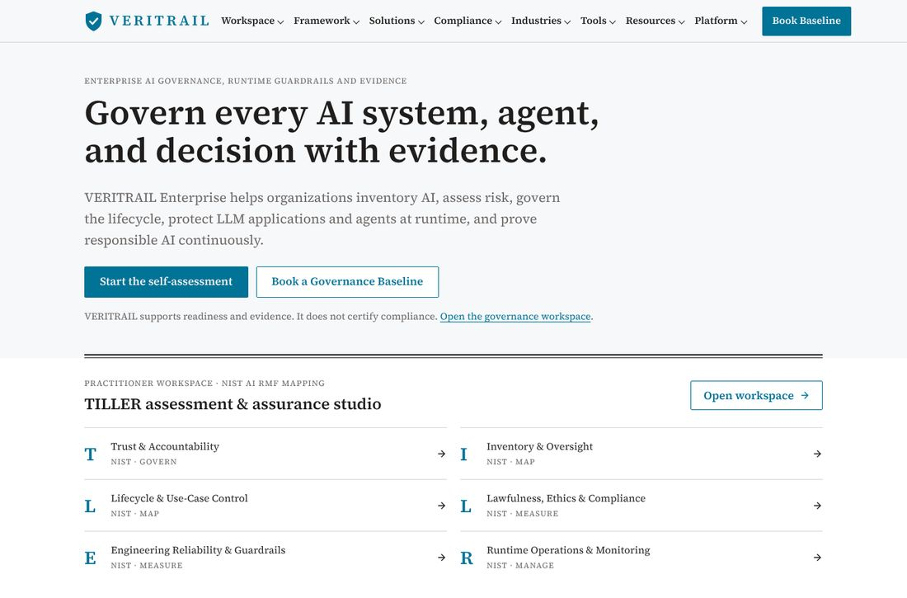
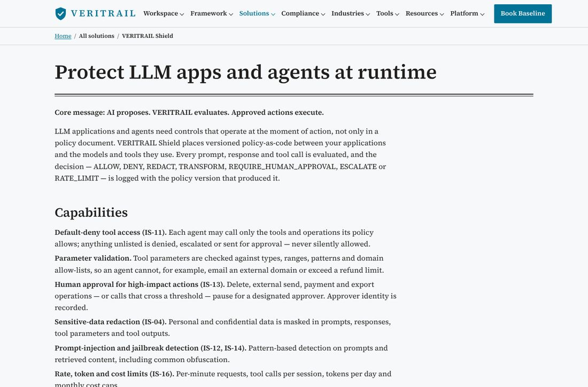
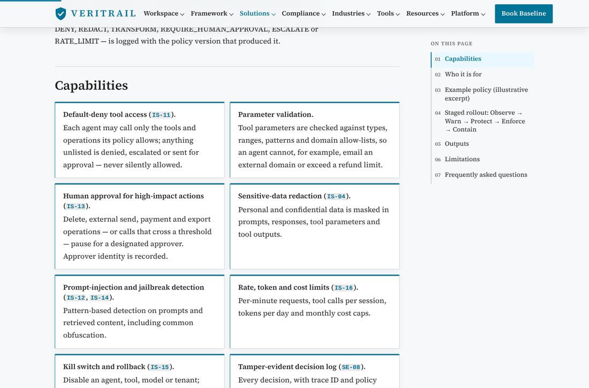
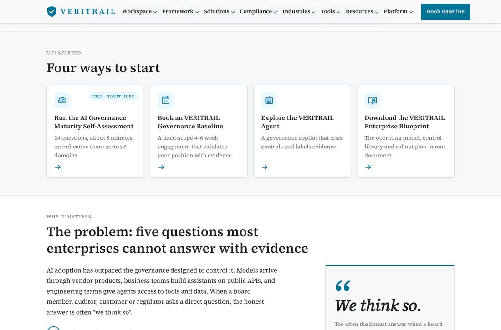
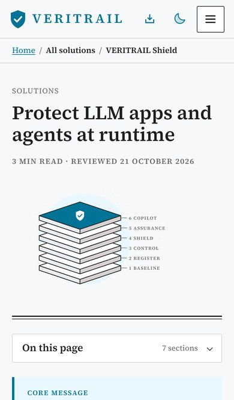
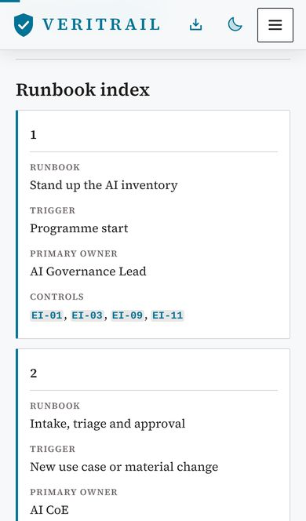
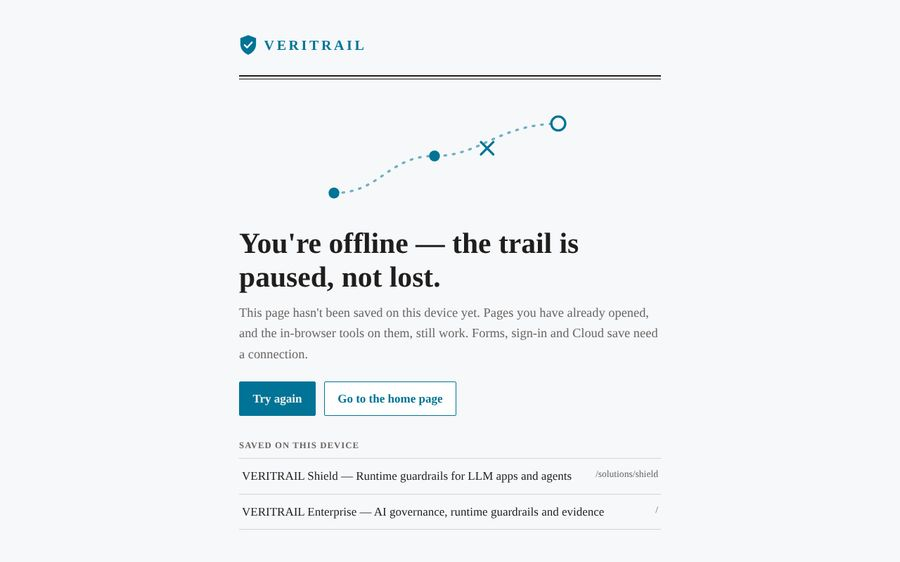

# VERITRAIL — UX uplift and installable app (PWA)

This note records the review of the public VERITRAIL website, the enhancements that were
implemented, how the installable app (PWA) works, and what is recommended next.

## 1. What the review found

VERITRAIL's content is strong, but the site presented it as a long broadsheet: about 40,000
words across 56 Markdown pages, no imagery at all, and very little visual structure beyond
headings and tables.

| # | Finding | Impact |
|---|---|---|
| 1 | **No images anywhere** — every page is text, tables and link lists | Pages feel dense; nothing anchors the eye or explains the model at a glance |
| 2 | **List markers missing** — Tailwind's reset removed bullets and numbers from all prose lists, so numbered questions and steps ran together as paragraphs | Readers lose the structure authors wrote (a real defect, on every page) |
| 3 | **Reading line of ~95 characters** on desktop, and an empty right-hand third on article pages | Long lines are tiring; the empty gutter wasted the space a page navigator needs |
| 4 | **284 bold-lead list items, 14 "Core message/question" lines, 50 pages with tables** presented as plain prose | Key messages and capabilities were not scannable |
| 5 | **Tables scrolled sideways on phones** | Comparisons were hard to read at 390 px |
| 6 | **Header wrapped to two rows on phones** (brand + CTA, then theme + Menu) | Wasted space; no sticky navigation on very long pages |
| 7 | **No page navigation or progress** on 1,000+ word pages | Hard to find a section or sense length |
| 8 | **PWA: manifest only** — two "V" icons (one declared `any maskable`), no screenshots or shortcuts, no service worker, no offline support, an iOS-only install tip, and `favicon.ico` was still the template's heart logo | Not installable with a good experience; nothing worked offline |

| Before — home | Before — article |
|---|---|
|  |  |

## 2. What was implemented

The governed Markdown in `platform/content/website_pages` is **unchanged** (the Python platform
renders the same files). Every improvement comes from the React renderer and templates reading
the structure authors already write.

### Reading experience (all 56 pages)

`src/features/site/markdown.tsx`, `reading.tsx`, `views.tsx`, `site.css`

- **Feature cards** — lists whose items open with **bold** become cards (a two-column grid for
  four or more short items).
- **Numbered timelines** — ordered lists with bold leads ("1. **Baseline.** …") become numbered
  steps joined by a line.
- **Link cards** — lists of links ("[Run the assessment](…) — 24 questions …") become clickable
  cards.
- **Key messages** — `**Core message: …**` / `**Core question: …**` render as callouts; other
  one-line bold paragraphs as lead callouts.
- **Sequences** — `**Baseline → Register → Control → …**` renders as numbered chips.
- **Control cross-links** — control IDs in text (`IS-11`, `GL-04` …) link to their control page,
  with the control title on hover (never inside headings or existing links).
- **Phone-friendly tables** — every cell is labelled with its column, so tables of up to five
  columns stack into cards below 640 px.
- **Code figures** — language label, line count, Copy button, and long blocks (over 18 lines)
  collapse behind "Show all N lines".
- **"On this page"** — a sticky rail with the current section highlighted on wide screens, and a
  collapsible list on phones, for pages with three or more sections.
- **Page header** — section eyebrow, reading time and review date, and a section illustration.
- **FAQ accordion**, **reading-progress bar**, **back-to-top button**, restored list markers, a
  70-character reading measure and ruled section breaks.

| After — article with section art and "On this page" | After — capabilities as cards, IDs linked |
|---|---|
|  |  |

### Images and visual system

`src/features/site/illustrations.tsx`

Twelve editorial illustrations, drawn as inline SVG with the site's own colour tokens. They are
sharp at every size, switch with light/dark mode, cost no network request and work offline:

- **Home hero — "the evidence trail"**: a dotted trail through Baseline → Register → Control →
  Shield to Assurance under the VERITRAIL shield, with inventory, maturity, runtime-policy and
  evidence-log cards. Gentle motion (trail flow, floating cards) is disabled for
  `prefers-reduced-motion`.
- **Section art** for Framework (five pillars), Solutions (six-layer stack), Compliance
  (readiness file with NIST / EU AI / ISO tabs), Industries (skyline), Tools (dashboard),
  Resources (blueprint and playbooks), Contact (calendar and conversation), Platform (policy
  console), Legal (signed document), Company and 404 (trail map) and the Blog (broadsheet).
- **Control mosaic** — data-driven: one tile per control, grouped by pillar and shaded by
  priority, read from `controls.yaml`. On a control's page the mosaic highlights that control.

Vector illustration was chosen over stock photography deliberately: it explains the model
instead of decorating it, stays on-brand in both themes, and keeps pages fast and offline-ready.

### Home page

`src/features/site/home.tsx` lays out `index.md` as a visual story; each section is parsed from
the Markdown and falls back to plain rendering if its shape changes.

- Hero with the evidence-trail illustration and a highlighted key word.
- **Proof strip**: 64 controls · 5 pillars · 6 layers · 24-question self-assessment (all counted
  from the content), and links to the NIST AI RMF, EU AI Act and ISO/IEC 42001 guides.
- **Four ways to start** as icon cards ("Free · start here" on the assessment).
- **The problem** as a numbered timeline beside a pull-quote — *"We think so."*
- **Six layers** as a numbered stack beside the layer illustration.
- **Five pillars** as cards with live control counts, next to the control mosaic.
- **How it works** as chips and a timeline beside the trail map.
- **Value by stakeholder** as role cards with icons; the closing CTAs side by side.

| After — home (desktop) | After — home sections |
|---|---|
|  |  |

| Phone — home | Phone — article | Phone — stacked table | Dark mode |
|---|---|---|---|
|  |  |  |  |

### Navigation

- Sticky, translucent header that gains a shadow on scroll; **one row on phones** (brand,
  install, theme, menu) with the "Book Governance Baseline" button moved into the menu.
- The mobile menu scrolls inside the viewport and closes with <kbd>Esc</kbd>.
- In the installed app (no browser toolbar) a **Back** button appears in the header.

## 3. The installable app (PWA)

### Install experience ("ask to install")

| Browser | What VERITRAIL offers |
|---|---|
| Chrome, Edge, Samsung Internet, Opera (Android, Windows, macOS, ChromeOS, Linux) | The browser's own install dialog — with app screenshots and description — from the install card or the header button |
| Safari on iPhone and iPad (and Chrome on iOS) | A step-by-step sheet: Share → Add to Home Screen → Add |
| Safari 17+ on macOS | A step-by-step sheet: File › Add to Dock |
| Firefox desktop, in-app browsers (Instagram, LinkedIn …) | Nothing — they cannot install web apps, so no button is shown |

- **Polite timing**: the install card appears only after two pages or 40 seconds of reading,
  never on sign-in, onboarding or contact forms. "Not now" snoozes it for 14 days.
- **Always available**: an install button in the website header and footer and in the workspace
  header, shown only where installation is possible.
- The browser's one-off `beforeinstallprompt` event is captured by an inline head script before
  React hydrates (`PWA_INIT_SCRIPT`), and shared by every entry point
  (`src/features/pwa/install-store.ts`).
- Install outcomes are counted through the existing cookieless `cta_click` event
  (`pwa-install-card`, `pwa-install-header`, `pwa-install-how`, `pwa-install-not-now`); no new
  analytics event names were added.

| iPhone: install card → instructions → menu → offline notice | In the workspace (above the tab bar) |
|---|---|
|  |  |

### Manifest and icons

`public/manifest.webmanifest`

- Name, short name, description, `id`, `start_url: /?source=pwa`, `standalone` display,
  categories and `launch_handler: focus-existing` (re-launching focuses the open window;
  shortcuts still navigate, via `launchQueue`).
- Icons from the shield mark: `any` 192/512, dedicated **maskable** 192/512 (mark inside the safe
  zone), an opaque 180 px Apple touch icon, the SVG favicon, and a new multi-size `favicon.ico`.
- **Shortcuts** (long-press / right-click the app icon): Self-assessment, Risk triage, Control
  library, Ask VERITRAIL, Workspace.
- **Screenshots** (wide and narrow) for the richer install dialog in Chrome and Edge.
- Regenerate with `node scripts/generate-pwa-icons.mjs` and
  `node scripts/capture-pwa-screenshots.mjs <running site URL>`.

### Offline support and the service worker

`public/sw.js`, `src/features/pwa/register.ts`, `public/offline.html`

| Request | Strategy |
|---|---|
| Pages (navigations) | **Network first** — online visitors always get the latest HTML; the copy is kept for offline reading (up to 80 pages) and a saved copy is shown after 6 s on a stalled connection |
| `/auth`, `/reset-password`, `/onboarding`, `/platform/admin`, any URL with a query string | Network only, never stored |
| Build assets (`/assets/*`, content-hashed) | Cache first |
| Icons, manifest, Google Fonts | Stale-while-revalidate |
| `POST`, server functions (`/_serverFn`), Supabase and every other origin | Not intercepted |

- After the first visit the page posts its loaded build assets to the worker ("warm"), so a page
  read once can be re-read offline with full styling and its in-browser tools.
- An unsaved page shows **`/offline.html`** — branded, theme-aware, with *Try again* and a list of
  the pages saved on the device.
- Offline / back-online notices explain that forms, sign-in and Cloud save need a connection.

**Lovable preview safety.** The worker is registered only on the published site: never in
development, inside an iframe (the Lovable editor), on Lovable preview hosts
(`id-preview--*.lovable.app`, `*.lovableproject.com` …) or on `localhost`. A worker found on a host
that must not have one is unregistered. To test a production build locally, run
`localStorage.setItem("veritrail-sw", "on")` and reload.

**Kill switch.** Replace `public/sw.js` with a worker that deletes the `veritrail-` caches and
calls `self.registration.unregister()` in `activate`; browsers pick it up on their next check.

### Verification

- `npm test` — 960 tests, including `src/test/pwa.test.ts` (host gating, platform detection,
  install timing and capture, manifest sizes and shortcuts, every service-worker routing rule) and
  `src/test/site-reading.test.ts` (each reading aid, and that every "On this page" link matches a
  rendered heading on all 56 pages).
- `npm run test:smoke` against a Node build — 152 pages at 1280 px and 390 px with no console
  errors, broken links or horizontal scrolling.
- In Chromium against the production build: the worker activates and controls the page, a
  visited page renders offline, an unvisited page shows the offline page, and
  `Page.getInstallabilityErrors` reports no manifest or icon errors.

## 4. Recommended next steps

1. **Real-device pass** on iOS Safari and Android Chrome after publishing (the install dialog
   depends on the published HTTPS origin).
2. **Workspace header on phones** wraps to a second row (its grid has four columns for seven
   controls) — consolidate the theme/export/install icons into a menu.
3. **Site search (⌘K)** across pages, controls and FAQs, built from the same Markdown.
4. **Glossary tooltips** for recurring terms (risk tier, evidence label, Observe/Warn/Protect).
5. **Per-page social images** generated from the section illustrations.
6. **Store listings** — package the PWA with PWABuilder for Google Play (TWA) and the Microsoft
   Store (MSIX) once the published domain is final.
7. **Governance briefing notifications** (Web Push) once a sending service and consent flow
   exist; offline queuing of lead forms is deliberately *not* done, because forms must say when
   nothing was recorded.
