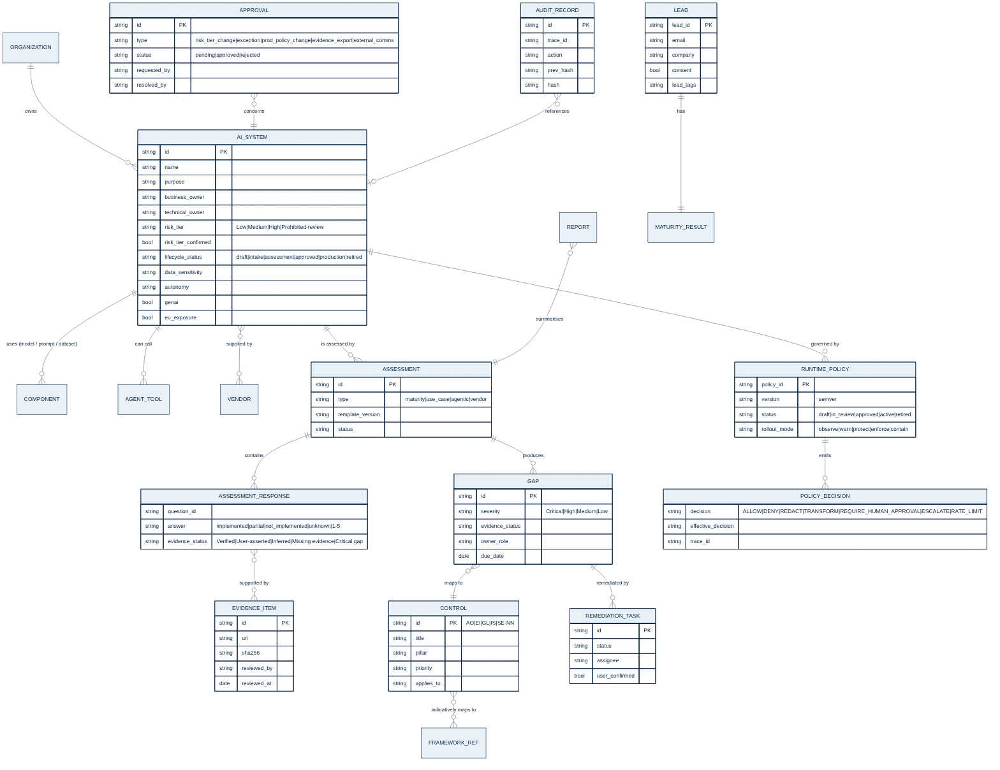

# VERITRAIL Data Model

Version 1.0 (MVP) · 21 October 2026

This document has two parts:
1. **Canonical model.** The target logical model that a production PostgreSQL schema should implement.
2. **MVP physical model.** Where each entity lives in this repository today: YAML content in git, JSON files and JSONL logs under `var/`.

## 1. Governed content (versioned in git)

| Entity | File | Key | Version field | Notes |
|---|---|---|---|---|
| Control library | `content/controls/controls.yaml` | `controls[].id` (`AO|EI|GL|IS|SE-NN`) | `library.version` | 64 controls: objective, evidence[], owner_role, priority, applies_to, domains[], modules[], mappings{nist_ai_rmf, iso_42001, eu_ai_act} |
| Pillar | same | `pillars[].id` | — | AO, EI, GL, IS, SE |
| Maturity template | `content/assessment_templates/maturity_self_assessment.yaml` | `template.id` | `template.version` | domains (weights), 24 questions, scale, scoring rules, flags, readiness groups, module/lead rules, CTA |
| Use-case question bank | `content/assessment_templates/use_case_assessment.yaml` | module id / question id | file version | Deep-dive modules with questions mapped to controls and expected evidence |
| Runtime policy pack | `content/policy_packs/*.yaml` | `policy_id` | `version` (semver) | Validated by `veritrail_policy.schema.validate_policy` |
| Industry pack | `content/industry_packs/*.yaml` | `id` | `version` | Use cases, emphasised controls, evidence expectations, regimes to consider |
| Email template | `content/email_templates.yaml` | template key | `version` | `status` + `approval{approved_by, approved_at, approval_ref}` |

## 2. Canonical entities

### AI_SYSTEM (inventory record) — control EI-01
| Field | Type | Notes |
|---|---|---|
| id | string PK | `sys_…` |
| name, purpose, description | string | Intended purpose (EI-04) |
| business_owner, technical_owner | string | Accountable owners (EI-03) |
| lifecycle_status | enum | draft · intake · assessment · approved · production · restricted · retired |
| risk_tier | enum | Low · Medium · High · Prohibited-review |
| risk_tier_status | enum | preliminary (Inferred) · confirmed (human) · change_pending (approval) |
| decision_impact, affected_parties, data_sensitivity, autonomy, domain_category | enum | Risk-tier inputs (see `veritrail_assessment.risk_tier.INTAKE_FIELDS`) |
| tools[] | list | Agent tools/APIs (EI-07) |
| genai, vendor_model, eu_exposure, external_actions | bool | |
| environment | enum | development · staging · production |
| created_at, updated_at, created_by | audit fields | |

### COMPONENT / AGENT_TOOL / VENDOR / DATA_SOURCE — controls EI-05, EI-06, EI-07, EI-08
Child records of AI_SYSTEM with version, provider, contract/DPA reference, permission scope (`read|write|delete|external_send|payment|export`) and data classification.

### ASSESSMENT — controls GL-02, EI-02
| Field | Type | Notes |
|---|---|---|
| id | string PK | `asm_…` |
| type | enum | maturity · use_case · agentic · vendor |
| system_id | FK → AI_SYSTEM | nullable for organization-level maturity |
| template_id, template_version | string | Reproducibility |
| modules[] | list | Selected from risk tier |
| risk | object | `calculate_risk_tier` output snapshot (Inferred) |
| status | enum | in_progress · completed · approved |
| responses[] | ASSESSMENT_RESPONSE | |

### ASSESSMENT_RESPONSE
| Field | Type | Notes |
|---|---|---|
| question_id | string | e.g. `SEC-Q2` or a use-case question ID |
| answer | enum / int | `implemented · partial · not_implemented · unknown` (use case) or `1–5` (maturity) |
| evidence_refs[] | FK → EVIDENCE_ITEM | |
| evidence_status | enum | Verified · User-asserted · Inferred · Missing evidence · Critical gap |
| answered_by, answered_at | audit fields | |

### EVIDENCE_ITEM — control SE-02
`id`, `uri/path`, `sha256`, `submitted_by`, `reviewed_by`, `reviewed_at`, `accepted` (bool), `note`. An evidence item makes a response **Verified** only when `reviewed_by` is a named human and `accepted = true`.

### GAP (finding)
| Field | Type | Notes |
|---|---|---|
| id | string | |
| assessment_id | FK | |
| question_id | string | Source question |
| control_ids[] | FK → CONTROL | At least one citation required |
| severity | enum | Critical · High · Medium · Low (SLA 30/60/90/180 days) |
| evidence_status | enum | as above |
| owner_role | string | From the control `owner_role` |
| action, due_date | string, date | |

### REMEDIATION_TASK
`id`, `assessment_id`, `gap_id`, `control_ids[]`, `owner`, `due_date`, `status` (open · in_progress · done · accepted_risk), `confirmed_by` (explicit user confirmation required).

### RUNTIME_POLICY — control IS-12
`policy_id`, `policy_name`, `version` (semver), `status` (draft · in_review · approved · active · retired), `applies_to{agent_name, environment, risk_tier, tenant}`, `rollout.mode` (observe · warn · protect · enforce · contain), `tools[]`, `content_controls`, `limits`, `logging`, `kill_switch`, `rollback`, `shadow_mode`, `evidence.retention_days`, `approval{required_roles, approved_by, approved_at}`, `change_history[]`, `citations[]`.

### POLICY_DECISION — control SE-08
`trace_id`, `policy_id`, `policy_version`, `request_type` (prompt · response · tool_call), `tool`, `decision`, `effective_decision` (after the rollout mode), `reasons[]`, `matched_rules[]`, `citations[]`, `redacted_payload_digest`, `ts`.

### APPROVAL — controls IS-13, GL-10
| Field | Type | Notes |
|---|---|---|
| approval_id | string PK | `apr_…` (agent) / `appr_…` (API email queue) |
| type | enum | risk_tier_change · exception · prod_policy_change · evidence_export · external_communication |
| resource_id | string | System, policy, export or message |
| payload_hash | string | Binds the approval to the exact payload |
| requested_by | string | Cannot approve their own request |
| status | enum | pending · approved · rejected |
| resolved_by, resolved_role, resolved_at, note | | Approver role required |

### REPORT
`id`, `assessment_id`, `formats[]` (md, pdf, csv, json), `paths`, `status` (draft · issued), `generated_at`, `trace_ids[]`.

### AUDIT_RECORD — control SE-08
`id`, `ts`, `trace_id`, `actor`, `action`, `resource`, `outcome`, `details` (redacted), `prev_hash`, `hash`. Append-only. Chain verified by `veritrail-admin audit verify`.

### LEAD / FORM_SUBMISSION / ANALYTICS_EVENT (go-to-market)
| Entity | Fields | Personal data |
|---|---|---|
| LEAD | lead_id, created_at, email, name, company, role, consent, marketing_opt_in, source, profile, overall_score, maturity_level, domain_scores, critical_flags, lead_tags, lead_labels, template_version | Yes — business contact data |
| FORM_SUBMISSION | id, form, created_at, email, name, company, role, message, ai_systems, industry, tool, consent | Yes |
| ANALYTICS_EVENT | ts, name, path, props (≤10 scalars, no email keys) | No |

## 3. MVP physical model

| Entity | Location | Writer |
|---|---|---|
| AI_SYSTEM | `var/agent/systems/sys_*.json` | `create_ai_system_record` |
| ASSESSMENT (+ responses, gaps) | `var/agent/assessments/asm_*.json` | `start_assessment`, `submit_assessment_response`, `identify_gaps` |
| EVIDENCE_ITEM | `var/agent/evidence/evd_*.json` | Evidence submission / `review_evidence` |
| REMEDIATION_TASK | `var/agent/tasks/tsk_*.json` | `create_remediation_task` (after confirmation) |
| REPORT | `var/agent/reports/rpt_*.json` + exported files | `generate_report` |
| RUNTIME_POLICY (drafts) | `var/agent/policies/pol_*.json` | `draft_runtime_policy` |
| APPROVAL | `var/agent/approvals/apr_*.json`, `var/approvals/appr_*.json` | `request_human_approval`, API email gate |
| Evidence export | `var/agent/exports/` | `export_evidence_pack` (after approval) |
| AUDIT_RECORD | `var/agent/audit/agent_audit.jsonl`, `var/audit/api_audit.jsonl`, `var/audit/admin_audit.jsonl`, policy-engine audit path | `AuditLog.append` |
| LEAD | `var/leads/leads.jsonl` + CRM adapter | `POST /api/leads` |
| Maturity report | `var/reports/lead_*.{md,pdf}` | `POST /api/leads` |
| FORM_SUBMISSION | `var/forms/submissions.jsonl` | `POST /api/contact` |
| ANALYTICS_EVENT | `var/analytics/events.jsonl` | `POST /api/events` |

All JSON record writes are atomic (temp file + `os.replace`). Record IDs are validated against `^[A-Za-z0-9_-]{1,80}$` to prevent path traversal.

## 4. Retention defaults (to be confirmed by legal — OQ-02)

| Data | Default | Basis |
|---|---|---|
| Leads, form submissions | 24 months after last interaction, or on request | Consent / legitimate interest |
| Maturity reports | 24 months | As leads |
| Audit records | 7 years in production; retained with pilot data during pilots | Assurance evidence (SE-02) |
| Runtime decision logs | Per policy `evidence.retention_days` (packs default 365) | SE-08 |
| Pilot customer data | Deleted or returned within 30 days of pilot end unless contracted | Pilot data-access safeguards |
| Analytics events | 13 months | Product analytics, no personal data |

## 5. Production schema notes
- PostgreSQL with row-level security per tenant. JSONB for flexible profile and answer payloads. Foreign keys as in the ERD.
- Evidence files go in object storage with SHA-256 digests in `EVIDENCE_ITEM`. Audit records are mirrored to WORM storage.
- PII columns (lead email and name) use column-level encryption and a separate access role.
