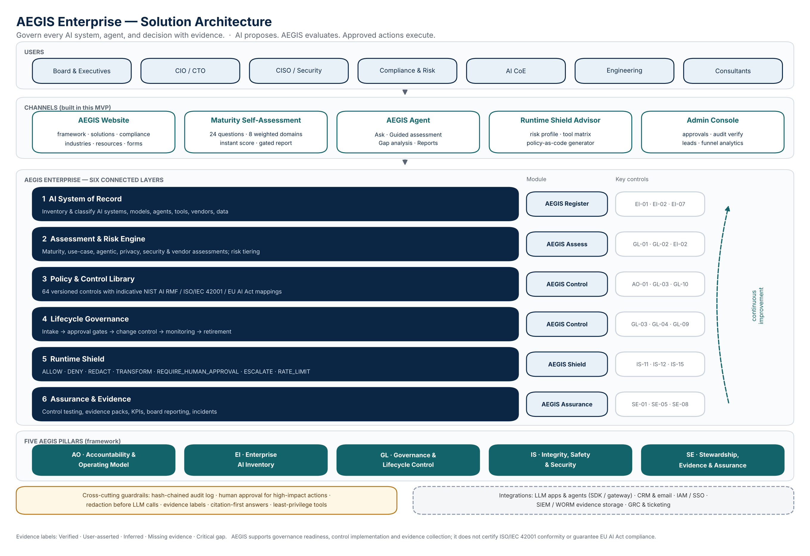
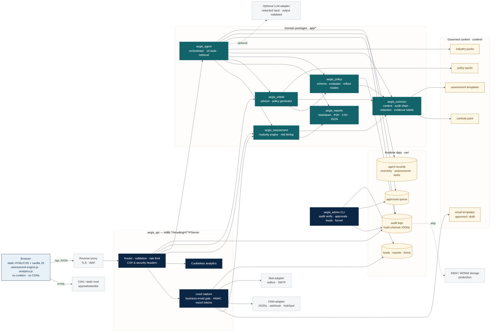
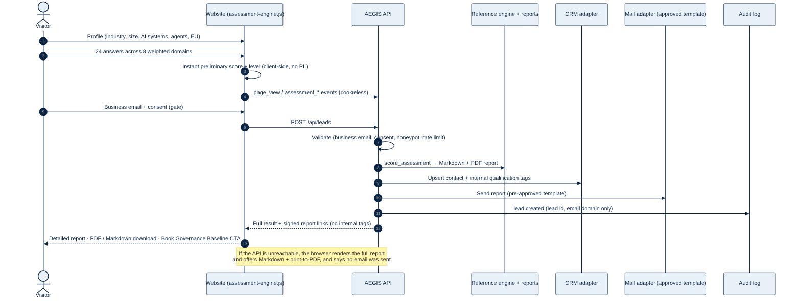
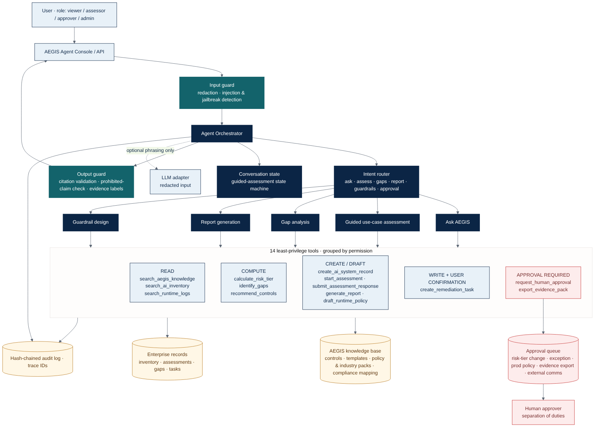
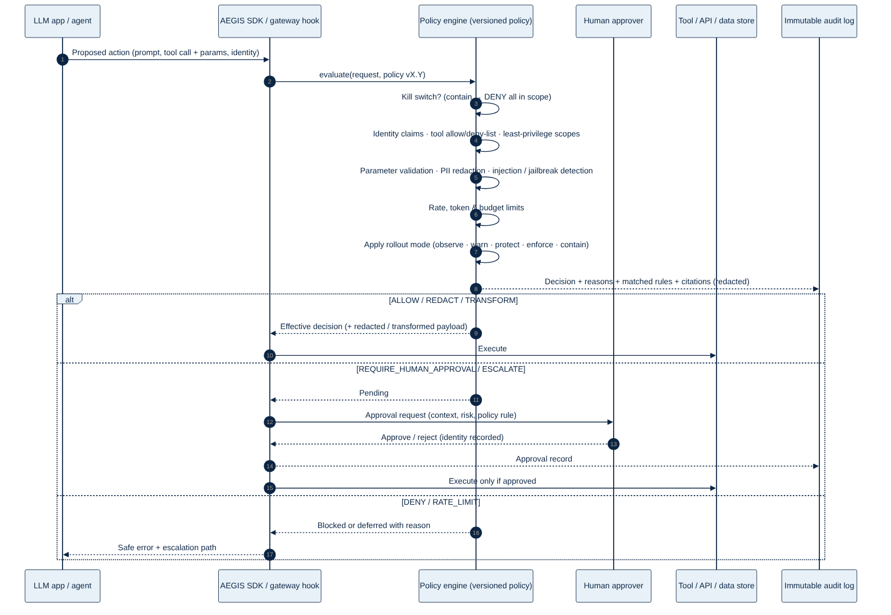
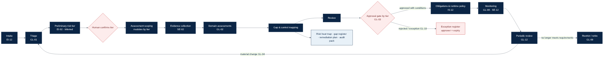

# VERITRAIL Technical Architecture

Version 1.0 (MVP) · 21 October 2026 · Owner: Enterprise Architect / Orchestrator

## 1. Purpose and scope

This document describes the architecture of the VERITRAIL MVP as built in this repository:
- the public website
- the AI Governance Maturity Self-Assessment
- the VERITRAIL Agent
- the Runtime Shield Advisor and policy engine
- reports, the API and the admin console

It also covers the path to a production deployment. Design decisions are recorded in [DECISION_LOG.md](DECISION_LOG.md).

Diagram sources live in [`docs/diagrams/`](diagrams/): Mermaid `.mmd` files plus `scripts/draw_architecture.py`. They are rendered to SVG and PNG with `scripts/render_diagrams.sh`.

## 2. Solution architecture



VERITRAIL Enterprise has **six connected layers**, organized under the **five VERITRAIL pillars** (AO, EI, GL, IS, SE):

| Layer | Responsibility | MVP implementation | Module |
|---|---|---|---|
| 1 AI System of Record | Inventory of systems, models, agents, tools, vendors and data | Agent `create_ai_system_record` / `search_ai_inventory` (JSON store), pilot inventory CSV template | Register |
| 2 Assessment & Risk Engine | Maturity, use-case, agentic and vendor assessment; risk tiering | `veritrail_assessment` (maturity engine, `calculate_risk_tier`), use-case question bank | Assess |
| 3 Policy & Control Library | Versioned controls with framework mappings | `content/controls/controls.yaml` (64 controls) | Control |
| 4 Lifecycle Governance | Intake → approval → change → monitoring → retirement | Approval service, remediation tasks, risk-tier confirmation, approval gates | Control |
| 5 Runtime Shield | Evaluate prompts, responses and tool calls against policy | `veritrail_policy` engine + `veritrail_shield` advisor/generator, policy packs | Shield |
| 6 Assurance & Evidence | Logs, evidence packs, reports, KPIs | `veritrail_common.audit`, `veritrail_reports`, `export_evidence_pack`, admin funnel/audit verify | Assurance |

## 3. Technical / deployment architecture



### 3.1 Components

| Component | Path | Technology | Notes |
|---|---|---|---|
| Static website | `app/website/` → `dist/` | Python SSG (Markdown + Jinja2), vanilla JS/CSS | No cookies, no CDNs. CSP-compatible (no inline script). SEO artefacts generated at build |
| Browser assessment engine | `app/website/static/js/assessment-engine.js` | ES2020 | Interprets the same YAML rules as Python. Parity-tested |
| API | `app/api/veritrail_api/` | stdlib `ThreadingHTTPServer` | Validation, rate limiting, security headers, lead capture, gated reports, tool endpoints |
| Assessment engine | `app/assessment-engine/veritrail_assessment/` | Python | Reference scoring, flags, plan, modules, lead rules. Use-case risk tiering |
| Reports | `app/reports/veritrail_reports/` | reportlab | Markdown → PDF. CSV (formula-injection safe), JSON |
| VERITRAIL Agent | `app/agent/veritrail_agent/` | Python | Deterministic orchestrator, BM25 retrieval, 14 tools, approvals, optional LLM adapter |
| Policy engine | `app/policy-engine/veritrail_policy/` | Python | Policy schema/validator, evaluator, rollout modes, kill switch, limits |
| Runtime Shield Advisor | `app/runtime-shield/veritrail_shield/` | Python | Risk profile, tool matrix, rules → versioned YAML/JSON policy |
| Common | `app/common/veritrail_common/` | Python | Content loaders, hash-chained audit log, redaction, injection detection, evidence labels, claim guard |
| Admin console | `app/admin/veritrail_admin/` | CLI | Audit verification, approvals (separation of duties), leads export, funnel |

### 3.2 Data stores (MVP)

| Store | Location | Contents | Sensitivity |
|---|---|---|---|
| Governed content | `content/` (git) | Controls, templates, packs, email templates, website copy | Public / internal |
| Audit logs | `var/audit/*.jsonl`, `var/agent/**/audit*.jsonl` | Hash-chained records (redacted) | Internal |
| Leads, reports, forms | `var/leads`, `var/reports`, `var/forms` | Personal data (business contact details) | **Confidential — PII** |
| Approvals | `var/approvals`, `var/agent/approvals` | Pending and resolved approvals | Internal |
| Agent records | `var/agent/` | Inventory, assessments, gaps, tasks, reports | Confidential |
| Analytics | `var/analytics/events.jsonl` | Cookieless events (no IP/UA) | Internal |

### 3.3 Request flows
- **Self-assessment and lead capture:** 
- **Agent:** 
- **Runtime decision:** 
- **Lifecycle governance:** 

## 4. Cross-cutting concerns

### 4.1 Security
- **Attack surface.** Only public endpoints are exposed over HTTP. Admin operations run through the CLI on the host.
- **Input handling.** 256 KiB body limit, JSON-only, strict email regex (blocks header injection), control-character stripping, honeypot field, per-client rate limit (salted in-memory hash; IPs not stored).
- **Output handling.** Jinja2 autoescape. JSON-LD serialised safely. CSV cells starting with `= + - @` are neutralised. PDF text is XML-escaped.
- **Headers.** Strict CSP (`default-src 'self'`, no inline script), `frame-ancestors 'none'`, `nosniff`, Referrer-Policy, Permissions-Policy, COOP.
- **Gated reports.** HMAC-SHA256 tokens bound to the lead ID, compared in constant time.
- **Path traversal.** Static paths are resolved and confined to the site root.
- **Agent safety.** Input redaction and injection/jailbreak detection, least-privilege tool permissions by role, a human approval queue with separation of duties, and output validation (citations plus the prohibited-claim guard).
- **Runtime Shield.** Default-deny tools. The kill switch takes precedence. Every decision is audited with redacted payloads.

### 4.2 Privacy
- Cookieless analytics with no personal data. DNT/GPC respected by the client.
- Lead data minimised to name, business email, company, role, answers and profile. Explicit consent is required. Marketing opt-in is separate.
- Audit logs hold lead IDs and email **domains**, never full emails.
- Redaction (`veritrail_common.redaction`) runs before any external LLM call and before audit writes.
- Retention: leads 24 months by default, audit 7 years for production systems (configurable; legal review pending — RISK_REGISTER).

### 4.3 Governance controls applied to VERITRAIL itself (dogfooding)

| Principle | Implementation | VERITRAIL control |
|---|---|---|
| Immutable audit | Hash-chained JSONL plus `audit verify` | SE-08 |
| Human approval for high-impact actions | Approval queue for tier changes, exceptions, prod policy, evidence export, external comms | IS-13, GL-10 |
| Least privilege | Tool permission levels × user roles. Public demo runs as `viewer` | IS-11 |
| Redaction before LLM | `redact()` in the agent input path and the LLM adapter | IS-04 |
| No compliance claims | `find_prohibited_claims()` in agent output, reports, CI content scan | AO-10, IS-08 |
| Change control | Versioned controls, templates, policies and email templates; decision log | GL-04 |
| Kill switch | Runtime policy `kill_switch` scopes; agent LLM adapter disabled by default | IS-15 |

### 4.4 Observability
- Trace IDs on every agent turn and tool call, plus API audit records.
- Funnel analytics from `veritrail-admin analytics funnel`.
- Production should export logs to a SIEM and metrics to Prometheus/OpenTelemetry (backlog).

### 4.5 Performance
- Static pages carry no render-blocking third-party resources. JS loads deferred and only on tool pages.
- The assessment runs client-side, so the preliminary result needs no network round-trip.

## 5. Quality and testing

| Suite | Path | Focus |
|---|---|---|
| Unit | `tests/unit` | Engine scoring, risk tier, reports, common utilities, website generator, content packs, ROI calculator |
| Integration | `tests/integration` | API flows, admin CLI, Python↔JS engine parity, website build |
| Agent evaluation | `tests/agent-evaluation` | ≥40 cases: citations, compliance-claim traps, injection, approvals, clarification |
| Policy engine | `tests/policy-engine` | Decisions, rollout modes, kill switch, limits, schema, packs |
| Security | `tests/security` | Traversal, oversize, content type, rate limit, email injection, XSS in site build, adversarial prompts, audit tamper |

CI: `.github/workflows/ci.yml` runs `make check`, `make site` and `make test`.

## 6. Deployment

### 6.1 MVP (single node)
```
make install && make site && make serve           # http://127.0.0.1:8080
# or
docker build -t veritrail . && docker run -p 8080:8080 -v veritrail-data:/data veritrail
```
Put it behind a TLS-terminating reverse proxy (nginx, Caddy or a cloud load balancer). Mount `/data` (`VERITRAIL_VAR_DIR`) on persistent, encrypted storage. Set `VERITRAIL_SECRET`, `VERITRAIL_PUBLIC_BASE_URL`, and the CRM/mail backend variables (API_SPECIFICATION §3).

### 6.2 Static-only hosting
`app/website/dist/` can be deployed to any static host or CDN. The self-assessment still produces the preliminary score and the full report client-side (Markdown download and print-to-PDF). Lead capture, emailed reports, the agent and the Shield advisor need the API. Route `/api/*` from the CDN to the API origin.

### 6.3 Production target architecture (backlog)

| Concern | MVP | Production target |
|---|---|---|
| API runtime | stdlib server | Same handlers behind gunicorn/uvicorn or containerised on Kubernetes/ECS, 2+ replicas |
| Storage | JSON/JSONL files | PostgreSQL (records), object storage (reports/evidence) with encryption at rest |
| Audit | Hash-chained JSONL | Plus WORM/object-lock bucket or SIEM with retention lock; periodic anchor hash |
| AuthN/Z | Role passed by caller; CLI on host | OIDC/SAML SSO, RBAC/ABAC, tenant isolation |
| Secrets | Env vars / local key file | Cloud KMS / secrets manager |
| Email/CRM | Outbox / JSONL | ESP with DKIM/SPF/DMARC and double opt-in; CRM via webhook/HubSpot |
| LLM | Optional adapter, off by default | Enterprise LLM endpoint (no training on data, regional), redaction gateway |
| Runtime Shield | In-process engine | SDK + sidecar/gateway, policy distribution with signed bundles |

## 7. Known limitations (MVP)
1. File-based storage is single-node and not designed for concurrent multi-instance writes.
2. Identity is caller-asserted in the agent API. The public endpoint is pinned to the `viewer` role. Authenticated roles need SSO before any non-demo use.
3. PII and injection detectors are heuristic (regex). Production needs a DLP service and a trained classifier.
4. The hash chain gives tamper evidence only. External anchoring or WORM storage is still required.
5. Framework mappings are indicative and need legal and standards-expert review. EU AI Act timelines are not asserted (DEC-0012).
6. No real CRM, ESP or hosting is configured. Placeholders are documented.
